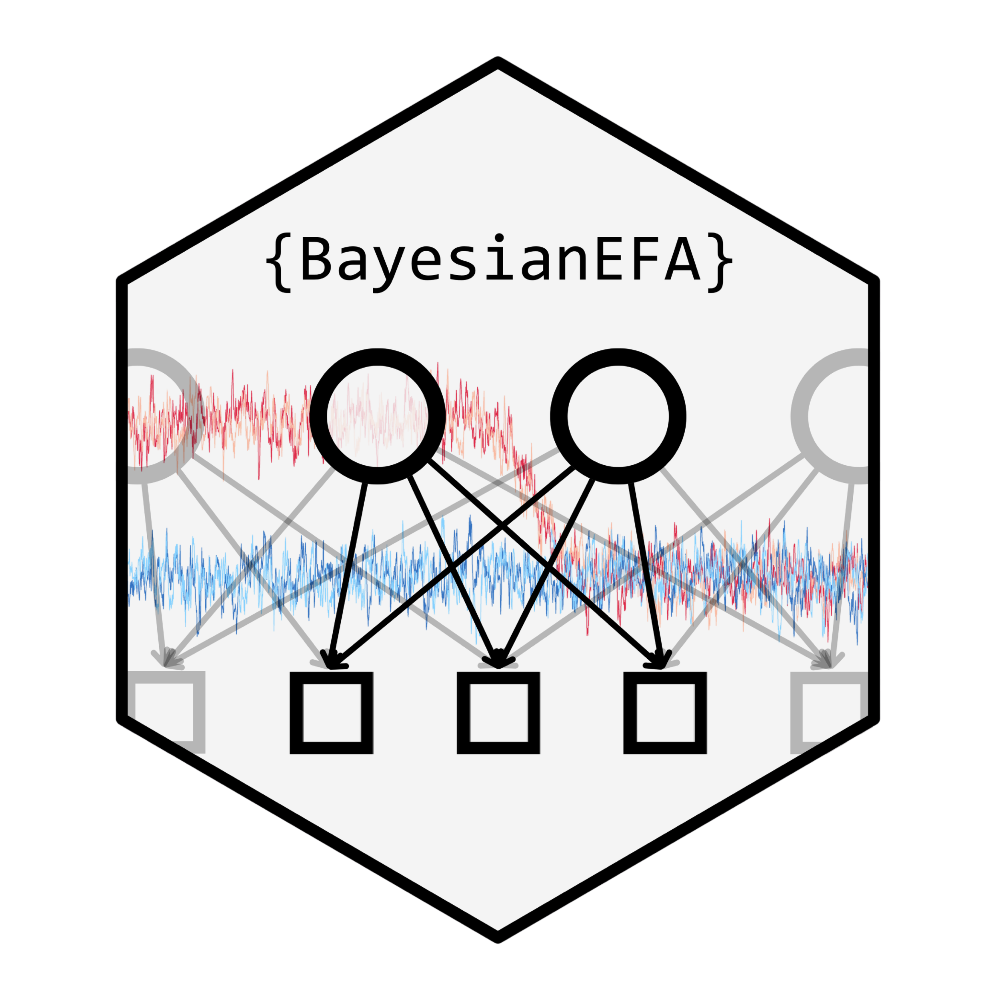

---
output:
  github_document:
    html_preview: false
---

<!-- README.md is generated from README.Rmd. Please edit that file and run
     vignettes/precompile.R, which also knits the vignettes. -->

```{r, include = FALSE}
knitr::opts_chunk$set(
  collapse = TRUE,
  comment = "#>",
  fig.path = "man/figures/README-",
  out.width = "80%"
)
```

# BayesianEFA: Bayesian Exploratory Factor Analysis 

<!-- badges: start -->
[](https://github.com/RicardoReySaez/BayesianEFA/actions/workflows/R-CMD-check.yaml)
[](https://app.codecov.io/gh/RicardoReySaez/BayesianEFA)
[](https://CRAN.R-project.org/package=BayesianEFA)
[](https://lifecycle.r-lib.org/articles/stages.html#experimental)
<!-- badges: end -->

The `BayesianEFA` package estimates Bayesian Exploratory Factor Analysis
(EFA) models with `Stan`. The loading matrix is left unrestricted, and its
rotational indeterminacy is solved after sampling with the Efficient
Rotation-Sign-Permutation (E-RSP) alignment. The package also provides
Bayesian fit indices, omega reliability coefficients and factor scores, each
with its full posterior distribution.

## Installation

You can install the development version of BayesianEFA from
[GitHub](https://github.com/RicardoReySaez/BayesianEFA) with:

```r
# install.packages("devtools")
devtools::install_github("RicardoReySaez/BayesianEFA")
```

The package installs in seconds: its Stan programs are generated when they are
needed, not compiled during installation. Its own C++ code needs the usual R
toolchain (Rtools on Windows; see below for macOS).

## Stan backends

`BayesianEFA` runs Stan through one of four optional interfaces. We recommend
**stanli**, which interprets Stan programs, needs no C++ compiler and starts
at once:

```r
install.packages("stanli", repos = c("https://seantalts.r-universe.dev",
                                     getOption("repos")))
stanli::stanli_install()
```

[cmdstanr](https://mc-stan.org/cmdstanr/), stanr and rstan work too. They
compile each model the first time it is needed and keep it in a cache for
later sessions; `befa_compile_models()` compiles them all in advance. With
`backend = "auto"` (the default), `befa()` uses the first one installed among
stanli, cmdstanr, stanr and rstan.

## Installation in macOS

Since `BayesianEFA` includes custom C++ functions, macOS users must configure
the R compilation toolchain. Following the recommendations from the
[latent](https://github.com/Marcosjnez/latent) package, we suggest using
`macrtools` by James Balamuta to automate this setup:

```r
# 1. Install macrtools
# install.packages("remotes")
remotes::install_github("coatless-mac/macrtools")

# 2. Setup the toolchain and OpenMP support
macrtools::macos_rtools_install()
macrtools::openmp_install()

# 3. Install BayesianEFA
devtools::install_github("RicardoReySaez/BayesianEFA")
```

## Quick Start

Here is a basic example showing how to fit a Bayesian EFA model:

```{r quick-start, message = FALSE}
library(BayesianEFA)

# Fit a 3-factor Bayesian EFA model to the Holzinger & Swineford data
befa_fit <- befa(data = HS_data, n_factors = 3, seed = 17)

# Print a summary of the model (inspired by the output of the psych package)
summary(befa_fit, cutoff = 0.3, signif_stars = TRUE)
```

For a complete guide on how to perform a Bayesian EFA from scratch, please
visit the [Getting Started](https://ricardoreysaez.github.io/BayesianEFA/articles/getting_started.html)
tutorial or explore the package website.
