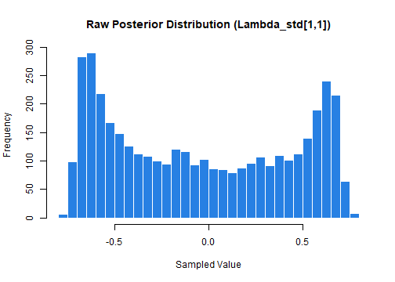
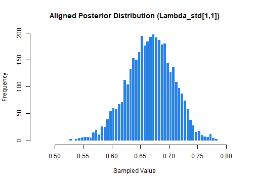

<!-- This vignette is precomputed: edit alignment.Rmd.orig and run
     vignettes/precompile.R from the package root. -->


Bayesian EFA models suffer from rotational indeterminacy, causing MCMC chains to "jump" between equivalent modes. This leads to label and sign switching across iterations which, if left uncorrected, causes posterior means to cancel out and results to become uninterpretable. To resolve this, `BayesianEFA` provides the `rsp_align()` function. This implements the Efficient Rotation-Sign-Permutation (E-RSP) algorithm proposed by Rey-Sáez & Revuelta (2026), an exact alignment method that recovers the underlying factor structure in seconds, even for high-dimensional models.

Let's begin by generating a dataset from a simple, two-dimensional latent structure. This will serve as our ground truth.


``` r
# Load BayesianEFA
library(BayesianEFA)

# Define a true loading matrix with a clear simple structure
L_true <- matrix(c(
  0.7, 0.0,
  0.7, 0.0,
  0.7, 0.0,
  0.0, 0.7,
  0.0, 0.7,
  0.0, 0.7
), ncol = 2, byrow = TRUE)

# Generate the corresponding correlation matrix
R_true <- tcrossprod(L_true)
diag(R_true) <- 1

# Simulate data for 300 observations
set.seed(2026)
X <- matrix(rnorm(300 * nrow(L_true)), ncol = nrow(L_true)) %*% chol(R_true)
colnames(X) <- paste0("Item_", 1:6)
```

## The unrotated solution

We will fit the Bayesian EFA model using `befa()`. To illustrate the pathology of rotational indeterminacy, we explicitly disable the internal alignment process by setting `rotate = "none"`; `refresh = 0` hides the progress bar.


``` r
# Fit the model without automatic post-processing
fit_unaligned <- befa(
  data = X,
  n_factors = 2,
  compute_fit_indices = FALSE,
  compute_reliability = FALSE,
  rotate = "none",
  seed = 17,
  refresh = 0,
  chains = 4
)
#> BayesianEFA: using the stanli backend.
#> Warning: the posterior may be unreliable: R-hat reaches 1.011; the effective sample size falls to 360.
#>   To fix it, increase `iter_sampling`.

# Save posterior draws
draws_unaligned <- extract_posterior_draws(
  fit_unaligned,
  pars = "Lambda_std",
  format = "matrix"
)
```

As we will see below, attempting to summarize the posterior distributions at this stage is meaningless due to rotational indeterminacy. By not applying any post-hoc alignment or rotation method, the MCMC chains have freely explored an unidentified, multimodal parameter space, generating several obvious anomalies in the summaries:

* **Null summaries:** Means and medians collapse toward zero as equivalent rotations with opposing signs cancel each other out.
* **Extreme uncertainty:** Posterior SDs and credible intervals become massive (e.g., spanning from -0.8 to +0.8), rendering the estimates uninformative.
* **Poor convergence diagnostics:** The lack of identification causes unstable convergence, reflected in $\hat{R}$ values above 1.00 and low effective sample sizes, as indicated by the output warning.


``` r
posterior_summaries(fit_unaligned, pars = "Lambda_std")
#> # A tibble: 12 × 10
#>    variable            mean   median    sd   mad     q5   q95  rhat ess_bulk ess_tail
#>    <chr>              <dbl>    <dbl> <dbl> <dbl>  <dbl> <dbl> <dbl>    <dbl>    <dbl>
#>  1 Lambda_std[1,1] -0.0440  -0.0947  0.482 0.689 -0.679 0.667  1.01     380.    1377.
#>  2 Lambda_std[2,1] -0.0536  -0.108   0.570 0.828 -0.803 0.788  1.01     360.    1038.
#>  3 Lambda_std[3,1] -0.0483  -0.0996  0.519 0.754 -0.730 0.715  1.01     395.    1615.
#>  4 Lambda_std[4,1]  0.00636  0.0219  0.481 0.695 -0.680 0.682  1.01     450.    1075.
#>  5 Lambda_std[5,1]  0.00346  0.00671 0.480 0.691 -0.682 0.686  1.01     465.    1315.
#>  6 Lambda_std[6,1]  0.00515  0.0165  0.484 0.697 -0.685 0.684  1.01     466.    1456.
#>  7 Lambda_std[1,2]  0.00365  0.00893 0.474 0.689 -0.667 0.674  1.01     454.    1333.
#>  8 Lambda_std[2,2] -0.00368  0.00750 0.559 0.806 -0.794 0.788  1.01     450.    1438.
#>  9 Lambda_std[3,2] -0.00426 -0.00376 0.508 0.738 -0.727 0.713  1.01     461.    1380.
#> 10 Lambda_std[4,2] -0.0447  -0.0941  0.490 0.705 -0.692 0.669  1.01     376.    1481.
#> 11 Lambda_std[5,2] -0.0462  -0.0901  0.488 0.706 -0.689 0.672  1.01     395.    1400.
#> 12 Lambda_std[6,2] -0.0460  -0.102   0.492 0.701 -0.694 0.677  1.01     367.    1582.
```

A visual inspection of the posterior draws for a specific parameter (e.g., `Lambda_std[1,1]`) makes the severity of this unidentified parameter space immediately apparent:


``` r
hist(draws_unaligned[, "Lambda_std[1,1]"],
  breaks = 50,
  col = "#2780e3",
  border = "white",
  main = "Raw Posterior Distribution (Lambda_std[1,1])",
  xlab = "Sampled Value"
)
```



Instead of a clean, unimodal distribution centered around the true value of $0.7$ (their true simulated value), we have a bimodal shape caused by the sampler traversing different orthogonal rotations.

## The rotated solution

To align the results, we pass the raw MCMC matrix to rsp_align(). Since samplers flatten multidimensional parameters (like the loading matrix $\mathbf{\Lambda}$) into vectors, the function requires specific formatting:

1.  **`lambda_draws`**: A numeric matrix of $S \times (J \times M)$, where $S$ is the total number of draws, $J$ is the number of items, and $M$ is the number of factors.
2.  **`n_chains`**: The number of MCMC chains. The function assumes the rows in `lambda_draws` are stacked chain by chain (e.g., if you have 4000 draws from 4 chains, rows 1-1000 belong to chain 1, rows 1001-2000 to chain 2, etc.).
3.  **`format`**: The most critical argument; it specifies how your MCMC software flattened the original $J \times M$ loading matrix into a single row.

### Understanding Flattening Formats

The lambda_draws input must be a 2D matrix of dimensions $S \times (J \times M)$. Since MCMC samplers flatten the original $J \times M$ loading matrix $\mathbf{\Lambda}$ into a single row vector, the format argument tells the function how to reconstruct it.

Consider a $4 \times 3$ loading matrix (4 items, 3 factors):
$$
\mathbf{\Lambda} = \begin{bmatrix}
\lambda_{11} & \lambda_{12} & \lambda_{13} \\
\lambda_{21} & \lambda_{22} & \lambda_{23} \\
\lambda_{31} & \lambda_{32} & \lambda_{33} \\
\lambda_{41} & \lambda_{42} & \lambda_{43}
\end{bmatrix}
$$

Depending on your MCMC software, the input rows must follow one of these two structures:

1. **Column-major** (`format = "column_major"`): Elements are filled **factor by factor**. This is the default output for `Stan` and matches the `as.vector(Lambda)` behavior in R:

$$
\text{vec}(\mathbf{\Lambda}) = [ \underbrace{\lambda_{11}, \lambda_{21}, \lambda_{31}, \lambda_{41}}_{\text{Factor 1}}, \, \underbrace{\lambda_{12}, \lambda_{22}, \lambda_{32}, \lambda_{42}}_{\text{Factor 2}}, \, \underbrace{\lambda_{13}, \lambda_{23}, \lambda_{33}, \lambda_{43}}_{\text{Factor 3}} ]
$$

2. **Row-major** (`format = "row_major"`): Elements are filled item by item. This corresponds to as.vector(t(Lambda)) in R:

$$
\text{vec}(\mathbf{\Lambda}^\top) = [ \underbrace{\lambda_{11}, \lambda_{12}, \lambda_{13}}_{\text{Item 1}}, \, \underbrace{\lambda_{21}, \lambda_{22}, \lambda_{23}}_{\text{Item 2}}, \, \underbrace{\lambda_{31}, \lambda_{32}, \lambda_{33}}_{\text{Item 3}}, \, \underbrace{\lambda_{41}, \lambda_{42}, \lambda_{43}}_{\text{Item 4}} ]
$$

We can easily visualize this difference by looking at the column names of our extracted draws. For an $6 \times 2$ loading matrix:


``` r
# 1. Draws in column-major order (Stan's default)
# Notice how it fills Factor 1 completely before moving to Factor 2
colnames(draws_unaligned)
#>  [1] "Lambda_std[1,1]" "Lambda_std[2,1]" "Lambda_std[3,1]" "Lambda_std[4,1]" "Lambda_std[5,1]"
#>  [6] "Lambda_std[6,1]" "Lambda_std[1,2]" "Lambda_std[2,2]" "Lambda_std[3,2]" "Lambda_std[4,2]"
#> [11] "Lambda_std[5,2]" "Lambda_std[6,2]"

# 2. Draws in row-major order
# We can simulate this order by transposing the index matrix
rw_ord <- rep(1:6, each = 2) + rep(c(0, 6), times = 2)
colnames(draws_unaligned)[rw_ord]
#>  [1] "Lambda_std[1,1]" "Lambda_std[1,2]" "Lambda_std[2,1]" "Lambda_std[2,2]" "Lambda_std[3,1]"
#>  [6] "Lambda_std[3,2]" "Lambda_std[4,1]" "Lambda_std[4,2]" "Lambda_std[5,1]" "Lambda_std[5,2]"
#> [11] "Lambda_std[6,1]" "Lambda_std[6,2]"
```

### Resolving the Latent Structure

Now that we have the correct format, we can apply the alignment algorithm. In this example (6 items, 2 factors, 4 chains), we use the `column_major` format to match our extraction tool:


``` r
# Apply the Efficient RSP algorithm
aligned_res <- rsp_align(
  lambda_draws = draws_unaligned,
  n_items = 6,
  n_factors = 2,
  n_chains = 4,
  format = "column_major",
  add_names = FALSE  # keep the column names of the input
)
```

By aligning the posterior draws, rotational indeterminacy is fully resolved. The previously observed anomalies disappear, and the true factor structure emerges with high precision and clarity:

* **Clear Factor Structure:** The previous non-significant loadings have been replaced by a simple structure. Items 1-3 now load onto Factor 1, with loadings from $0.67$ to $0.80$, while Items 4-6 load onto Factor 2, with $\lambda \approx 0.68$ for all of them.
* **High precision:** Posterior standard deviations have decreased significantly, from $\approx 0.50$ down to $0.04$-$0.05$, resulting in narrow, informative credible intervals that clearly exclude zero for all main loadings.
* **Convergence and mixing:** With the model now identified, all $\hat{R}$ values are at or below $1.01$, and the bulk effective sample sizes (ESS) exceed 2500, confirming efficient mixing and stable chains.


``` r
# Now, aligned posterior summaries are interpretable
aligned_res$summary
#> # A tibble: 12 × 10
#>    variable            mean   median     sd    mad      q5     q95  rhat ess_bulk ess_tail
#>    <chr>              <dbl>    <dbl>  <dbl>  <dbl>   <dbl>   <dbl> <dbl>    <dbl>    <dbl>
#>  1 Lambda_std[1,1]  0.667    0.668   0.0412 0.0408  0.597   0.731  1.00     3240.    2721.
#>  2 Lambda_std[2,1]  0.798    0.798   0.0396 0.0398  0.732   0.861  1.00     2589.    2223.
#>  3 Lambda_std[3,1]  0.725    0.726   0.0400 0.0403  0.657   0.787  1.00     2502.    2196.
#>  4 Lambda_std[4,1] -0.0499  -0.0506  0.0465 0.0464 -0.124   0.0258 1.000    4431.    3474.
#>  5 Lambda_std[5,1] -0.00304 -0.00358 0.0464 0.0464 -0.0797  0.0739 1.00     4091.    3408.
#>  6 Lambda_std[6,1] -0.0332  -0.0322  0.0464 0.0452 -0.111   0.0434 1.00     4621.    3176.
#>  7 Lambda_std[1,2] -0.0966  -0.0966  0.0488 0.0486 -0.178  -0.0164 1.00     4322.    3564.
#>  8 Lambda_std[2,2] -0.0136  -0.0128  0.0405 0.0399 -0.0804  0.0518 1.00     4399.    3472.
#>  9 Lambda_std[3,2]  0.00849  0.00860 0.0447 0.0442 -0.0654  0.0819 1.00     4342.    3600.
#> 10 Lambda_std[4,2]  0.683    0.684   0.0469 0.0462  0.602   0.757  1.00     2652.    2192.
#> 11 Lambda_std[5,2]  0.683    0.684   0.0472 0.0457  0.603   0.760  1.00     2919.    2737.
#> 12 Lambda_std[6,2]  0.687    0.688   0.0471 0.0472  0.608   0.763  1.00     2909.    2280.
```

Re-visualizing the posterior distribution for `Lambda_std[1,1]` after alignment provides clear visual proof that the parameter is now identified. The formerly erratic, multimodal draws have successfully resolved into a clean, unimodal distribution, confirming that rotational indeterminacy has been completely eliminated.


``` r
# Retrieve the clean, aligned posterior matrix
draws_aligned <- aligned_res$Lambda_hat_mcmc

# The output maintains the exact dimensions and format of the input
hist(draws_aligned[, "Lambda_std[1,1]"],
  breaks = 50,
  col = "#2780e3",
  border = "white",
  main = "Aligned Posterior Distribution (Lambda_std[1,1])",
  xlab = "Sampled Value"
)
```



In practice, there is no need to call `rsp_align()` yourself: `befa()` rotates
every draw with Varimax and aligns them with E-RSP by default
(`rotate = "varimax"`), and returns the aligned draws. Calling it directly is
useful for draws from other software, such as a factor model written by hand
in Stan.

## References

- Papastamoulis, P., & Ntzoufras, I. (2022). On the identifiability of Bayesian factor analytic models. *Statistics and Computing, 32*(2), 23. <https://doi.org/10.1007/s11222-022-10084-4>
- Rey-Sáez, R., & Revuelta, J. (2026). An efficient rotation-sign-permutation algorithm to solve rotational indeterminacy in Bayesian exploratory factor analysis. *Bayesian Analysis*. Advance publication. <https://doi.org/10.1214/26-BA1611>
