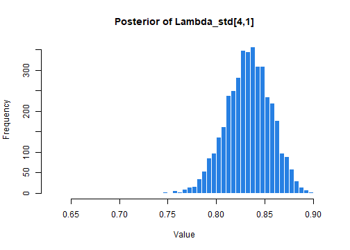

<!-- This vignette is precomputed: edit getting_started.Rmd.orig and run
     vignettes/precompile.R from the package root. -->


## Introduction

`BayesianEFA` fits Bayesian Exploratory Factor Analysis models with Stan.

- **Unconstrained estimation**: the loading matrix is left free, with no fixed
  parameters or arbitrary identification constraints.
- **Rotational indeterminacy solved**: the draws are aligned with Varimax and
  the Efficient Rotation-Sign-Permutation (E-RSP) algorithm, so the posterior
  of every loading is interpretable.
- **Bayesian fit measures**: the Bayesian SEM fit indices of
  Garnier-Villarreal & Jorgensen (2020) and PSIS-LOO.
- **Full posterior inference**: complete distributions for the loadings, the
  factor scores, the fit measures and the reliability coefficients.
- **FIML for missing data**: incomplete data sets use every observed value.
- **No Heywood cases**: the unit-vector prior keeps every communality below 1.

## Stan backends

`BayesianEFA` writes the Stan program of each model itself and runs it with
one of four interfaces to Stan, all optional:

- **stanli** interprets Stan programs, so it needs no C++ compiler and starts
  at once. It is the default when it is installed:

  ```r
  install.packages("stanli", repos = c("https://seantalts.r-universe.dev",
                                       getOption("repos")))
  stanli::stanli_install()
  ```

- **cmdstanr**, **stanr** and **rstan** compile each program the first time it
  is needed (half a minute to a minute) and keep it in a cache, so later
  sessions start at once. `befa_compile_models()` compiles every program in
  advance, and `befa_clear_cache()` removes them.

With `backend = "auto"` (the default), `befa()` uses the first one installed
among stanli, cmdstanr, stanr and rstan; `backend = "cmdstanr"`, for instance,
chooses one.

## Fitting a model

The following call fits a three-factor model to the Holzinger and Swineford
(1939) data, aligns the draws, and computes the fit indices, the omega
coefficients and, on request, the factor scores:


``` r
library(BayesianEFA)
#> 
#> ────────────────────────────────────────────────────────────
#>  BayesianEFA (v0.1.0.9000): Bayesian Exploratory Factor Analysis
#> ────────────────────────────────────────────────────────────

befa_fit <- befa(
  data = HS_data,        # one row per person, one column per item
  n_factors = 3,         # number of latent factors
  factor_scores = TRUE,  # also draw the factor scores
  seed = 17              # for reproducible results
)
#> BayesianEFA: using the stanli backend.
#> ── Bayesian exploratory factor analysis ────────────────────────────────────────────────── stanli ──
#> ℹ 4 chains of 1000 draws after 1000 warmup iterations, 4 at a time.
#> ✔ Sampled 4 chains in 2.6s.
#> ✔ No divergent transitions.
#> ✔ No transition reached the maximum tree depth (15).
#> ✔ Largest R-hat 1.003, below 1.01.
#> ✔ Smallest effective sample size 2169, above 400.
#> ℹ Drawing the factor scores.
#> ℹ Computing the fit indices and the null model.
```

By default, `befa()` fits the correlation matrix (`model = "cor"`) with the
unit-vector prior on the loadings, and runs four chains of 1000 warmup and
1000 kept iterations of NUTS. After sampling it checks the convergence of the
parameters it returns: the aligned loadings, the uniquenesses and the
communalities.

## Model summary

`summary()` prints tables inspired by the `psych` package. The factors are
ordered by the variance they explain, and the items, listed by their names,
are grouped by the factor of their largest loading (`sort = FALSE` keeps their
original order; long names are shortened to keep the width of the table).
`cutoff` hides the loadings below a threshold, and `signif_stars` marks those
whose 95% credible interval excludes zero. The second table gives the variance
each factor explains:


``` r
summary(befa_fit, cutoff = 0.3, signif_stars = TRUE)
#> 
#> Table 1. Standardized Factor Loadings 
#> ‗‗‗‗‗‗‗‗‗‗‗‗‗‗‗‗‗‗‗‗‗‗‗‗‗‗‗‗‗‗‗‗‗‗‗‗‗‗‗‗‗‗‗‗‗‗‗‗‗‗‗‗‗‗‗‗‗‗‗‗‗‗‗‗‗‗‗ 
#> Variable       F1     F2     F3    h2    u2  Rhat  EssBulk  EssTail
#> ———————————————————————————————————————————————————————————————————
#> x5          0.86*                0.75  0.25  1.00     3716     3149
#> x4          0.83*                0.71  0.29  1.00     3756     3125
#> x6          0.81*                0.69  0.31  1.00     3943     3132
#> x8                 0.69*         0.53  0.47  1.00     2655     2169
#> x7                 0.68*         0.49  0.51  1.00     2864     2196
#> x9                 0.49*  0.40*  0.44  0.56  1.00     3834     2732
#> x3                        0.65*  0.45  0.55  1.00     3810     2267
#> x1          0.31*         0.60*  0.48  0.52  1.00     3744     2880
#> x2                        0.47*  0.25  0.75  1.00     3212     2673
#> ‗‗‗‗‗‗‗‗‗‗‗‗‗‗‗‗‗‗‗‗‗‗‗‗‗‗‗‗‗‗‗‗‗‗‗‗‗‗‗‗‗‗‗‗‗‗‗‗‗‗‗‗‗‗‗‗‗‗‗‗‗‗‗‗‗‗‗ 
#> Note: varimax rotation applied; MCMC with stanli. Diagnostics show
#> worst-case values across factors (max Rhat, min ESS). (*) 95%
#> Credible Interval excludes 0. Loadings with absolute values < 0.30
#> are hidden. 
#> 
#> Table 2. Variance Explained 
#> ‗‗‗‗‗‗‗‗‗‗‗‗‗‗‗‗‗‗‗‗‗‗‗‗‗‗‗‗‗‗‗‗‗‗‗‗‗‗‗‗‗‗‗‗‗‗‗‗‗‗ 
#> Statistic                    F1    F2    F3  Total
#> ——————————————————————————————————————————————————
#> Sum of squared loadings    2.27  1.27  1.26   4.79
#> Proportion of total        0.47  0.26  0.26   1.00
#> Proportion of variance     0.25  0.14  0.14   0.53
#> Cumulative variance        0.25  0.39  0.53       
#> ‗‗‗‗‗‗‗‗‗‗‗‗‗‗‗‗‗‗‗‗‗‗‗‗‗‗‗‗‗‗‗‗‗‗‗‗‗‗‗‗‗‗‗‗‗‗‗‗‗‗ 
#> Note: Posterior means. Proportion of total: share
#> of the explained variance. 
#> 
#> Table 3. Bayesian Fit Measures 
#> ‗‗‗‗‗‗‗‗‗‗‗‗‗‗‗‗‗‗‗‗‗‗‗‗‗‗‗‗‗‗‗‗‗‗‗‗‗‗‗‗‗‗‗‗‗ 
#> Index         Estimate    SD  CI_Low  CI_High
#> —————————————————————————————————————————————
#> Chi2             47.05  6.92   35.44    62.49
#> Chi2_ppp          0.12                       
#> Chi2_Null       918.85  0.00  918.85   918.85
#> BRMSEA            0.05  0.02    0.00     0.09
#> BGamma            0.99  0.00    0.98     1.00
#> Adj_BGamma        0.97  0.02    0.94     1.00
#> BMc               0.98  0.01    0.96     1.00
#> SRMR              0.05  0.01    0.03     0.06
#> BCFI              0.99  0.01    0.97     1.00
#> BTLI              0.99  0.02    0.94     1.00
#> ‗‗‗‗‗‗‗‗‗‗‗‗‗‗‗‗‗‗‗‗‗‗‗‗‗‗‗‗‗‗‗‗‗‗‗‗‗‗‗‗‗‗‗‗‗ 
#> Note: Intervals are 95% credible intervals.
#> PPP: Posterior Predictive p-value (Ideal >
#> .05). 
#> 
#> Table 4. Information Criteria 
#> ‗‗‗‗‗‗‗‗‗‗‗‗‗‗‗‗‗‗‗‗‗‗‗‗‗‗‗‗‗‗‗‗‗‗‗‗‗‗‗‗‗‗‗‗‗‗‗‗ 
#> Criterion    Estimate     SE    CI_Low   CI_High
#> ————————————————————————————————————————————————
#> ELPD         -3420.92  42.68  -3504.58  -3337.27
#> LOOIC         6841.84  85.36   6674.54   7009.15
#> p_loo           25.26   1.79     21.76     28.76
#> WAIC          6841.75  85.35   6674.47   7009.04
#> p_WAIC          25.21   1.78     21.72     28.70
#> DIC           6839.65  84.04   6674.93   7004.37
#> p_D             23.64   0.80     22.08     25.21
#> DIC_i         6839.94  79.98   6683.17   6996.70
#> p_V             23.93   5.57     13.03     34.84
#> BPIC          6863.29  84.41   6697.85   7028.73
#> ‗‗‗‗‗‗‗‗‗‗‗‗‗‗‗‗‗‗‗‗‗‗‗‗‗‗‗‗‗‗‗‗‗‗‗‗‗‗‗‗‗‗‗‗‗‗‗‗ 
#> Note: SEs across persons (jackknife for DIC_i
#> and p_V); 95% normal intervals. 
#> 
#> Table 5. Factor Reliability (Omega) 
#> ‗‗‗‗‗‗‗‗‗‗‗‗‗‗‗‗‗‗‗‗‗‗‗‗‗‗‗‗‗‗‗‗‗‗‗‗‗‗‗‗‗ 
#> Factor    Estimate    SD  CI_Low  CI_High
#> —————————————————————————————————————————
#> F1            0.73  0.02    0.69     0.76
#> F2            0.55  0.04    0.45     0.62
#> F3            0.60  0.04    0.52     0.67
#> Total         0.84  0.01    0.82     0.86
#> ‗‗‗‗‗‗‗‗‗‗‗‗‗‗‗‗‗‗‗‗‗‗‗‗‗‗‗‗‗‗‗‗‗‗‗‗‗‗‗‗‗ 
#> Note: Total is the omega of the full
#> scale. Omega coefficients use the
#> standardized solution.
```

## Posterior draws

The fit holds the draws of the final parameters in the metric of the model:
`Lambda_std`, `Psi_std` and `h2` for the correlation model.
`extract_posterior_draws()` returns them in any format of the `posterior`
package, and `posterior_summaries()` summarises them with their convergence
diagnostics:


``` r
draws <- extract_posterior_draws(befa_fit, pars = "Lambda_std")

hist(draws[, "Lambda_std[4,1]"],
  breaks = 50,
  col = "#2780e3",
  border = "white",
  main = "Posterior of Lambda_std[4,1]",
  xlab = "Value"
)
```



``` r

posterior_summaries(befa_fit, pars = "h2")
#> # A tibble: 9 × 10
#>   variable  mean median     sd    mad    q5   q95  rhat ess_bulk ess_tail
#>   <chr>    <dbl>  <dbl>  <dbl>  <dbl> <dbl> <dbl> <dbl>    <dbl>    <dbl>
#> 1 h2[1]    0.478  0.476 0.0623 0.0622 0.378 0.585 1.00     4029.    2516.
#> 2 h2[2]    0.249  0.247 0.0572 0.0580 0.158 0.344 1.00     3542.    2660.
#> 3 h2[3]    0.451  0.448 0.0748 0.0733 0.330 0.575 1.000    3713.    2300.
#> 4 h2[4]    0.715  0.714 0.0355 0.0364 0.655 0.772 1.00     4866.    2990.
#> 5 h2[5]    0.751  0.752 0.0384 0.0377 0.687 0.810 1.00     4933.    3055.
#> 6 h2[6]    0.687  0.689 0.0346 0.0348 0.628 0.741 1.00     5033.    3229.
#> 7 h2[7]    0.490  0.484 0.0974 0.0951 0.343 0.658 1.00     2863.    2247.
#> 8 h2[8]    0.527  0.522 0.0850 0.0826 0.398 0.675 1.00     2826.    2181.
#> 9 h2[9]    0.445  0.445 0.0553 0.0547 0.355 0.536 1.000    4352.    2778.
```

## Fit measures, reliability and factor scores

The fit indices and the omega coefficients are part of the fit, and their
functions return them with every draw:


``` r
befa_fit_measures(befa_fit)
#> 
#> Table 1. Bayesian Fit Measures 
#> ‗‗‗‗‗‗‗‗‗‗‗‗‗‗‗‗‗‗‗‗‗‗‗‗‗‗‗‗‗‗‗‗‗‗‗‗‗‗‗‗‗‗‗‗‗‗‗ 
#> Index         Estimate     SD   CI_Low  CI_High
#> ———————————————————————————————————————————————
#> Chi2            47.047  6.919   35.443   62.494
#> Chi2_ppp         0.115                         
#> Chi2_Null      918.852  0.000  918.852  918.852
#> BRMSEA           0.055  0.020    0.000    0.091
#> BGamma           0.992  0.005    0.981    1.000
#> Adj_BGamma       0.973  0.017    0.936    1.000
#> BMc              0.982  0.011    0.957    1.000
#> SRMR             0.046  0.008    0.033    0.064
#> BCFI             0.987  0.008    0.970    1.000
#> BTLI             0.989  0.018    0.938    1.000
#> ‗‗‗‗‗‗‗‗‗‗‗‗‗‗‗‗‗‗‗‗‗‗‗‗‗‗‗‗‗‗‗‗‗‗‗‗‗‗‗‗‗‗‗‗‗‗‗ 
#> Note: Intervals are 95% credible intervals.
#> PPP: Posterior Predictive p-value (Ideal >
#> .05). 
#> 
#> Table 2. Information Criteria 
#> ‗‗‗‗‗‗‗‗‗‗‗‗‗‗‗‗‗‗‗‗‗‗‗‗‗‗‗‗‗‗‗‗‗‗‗‗‗‗‗‗‗‗‗‗‗‗‗‗‗‗‗‗ 
#> Criterion     Estimate      SE     CI_Low    CI_High
#> ————————————————————————————————————————————————————
#> ELPD         -3420.922  42.681  -3504.575  -3337.270
#> LOOIC         6841.845  85.361   6674.539   7009.150
#> p_loo           25.259   1.787     21.757     28.761
#> WAIC          6841.754  85.352   6674.467   7009.040
#> p_WAIC          25.213   1.781     21.722     28.705
#> DIC           6839.648  84.041   6674.931   7004.366
#> p_D             23.644   0.799     22.078     25.210
#> DIC_i         6839.939  79.984   6683.173   6996.705
#> p_V             23.935   5.565     13.027     34.842
#> BPIC          6863.292  84.409   6697.854   7028.730
#> ‗‗‗‗‗‗‗‗‗‗‗‗‗‗‗‗‗‗‗‗‗‗‗‗‗‗‗‗‗‗‗‗‗‗‗‗‗‗‗‗‗‗‗‗‗‗‗‗‗‗‗‗ 
#> Note: SEs across persons (jackknife for DIC_i and
#> p_V); 95% normal intervals.

befa_reliability(befa_fit)$subscales
#>     Estimate         SD     Lower     Upper
#> F1 0.7278639 0.01814628 0.6897123 0.7609152
#> F2 0.5478136 0.04399910 0.4475266 0.6194237
#> F3 0.6013457 0.03756647 0.5231495 0.6691458

scores <- befa_factor_scores(befa_fit)
head(matrix(scores$summary$mean, ncol = 3))
#>             [,1]         [,2]       [,3]
#> [1,]  0.03703608 -0.007814997 -0.7407386
#> [2,] -1.15645271  0.807356652  0.6105501
#> [3,] -1.81631473 -1.027761410 -0.1749536
#> [4,]  0.00153251 -0.788665320  0.7202735
#> [5,] -0.09547967  0.347195283 -0.5267673
#> [6,] -1.47310529  1.136715301  0.4621096
```

## How many factors?

Several values of `n_factors` fit one model per value, with the same settings
and seed. The saturated and null models are estimated once, and the models are
compared with `befa_compare()`:


``` r
fits <- befa(HS_data, n_factors = 1:3, seed = 17, verbose = FALSE)
summary(fits)
#> 
#> Bayesian EFA with 1, 2, 3 factors
#> Data model: cor; prior: unit_vector; N = 301; rotation: varimax; MCMC with
#> stanli. 
#> 
#> Table 1. Overview of the Models 
#> ‗‗‗‗‗‗‗‗‗‗‗‗‗‗‗‗‗‗‗‗‗‗‗‗‗‗‗‗‗‗‗‗‗‗‗‗‗‗‗‗‗‗‗‗‗‗‗‗‗‗‗‗‗‗‗‗‗‗‗ 
#> Model     Rhat   ESS  Div  BRMSEA   BCFI      ELPD     WAIC
#> ———————————————————————————————————————————————————————————
#> nf1      1.004  2753    0   0.194  0.677  -3550.64  7101.23
#> nf2      1.002  1879    0   0.158  0.874  -3468.93  6937.80
#> nf3      1.003  2169    0   0.055  0.987  -3420.92  6841.75
#> ‗‗‗‗‗‗‗‗‗‗‗‗‗‗‗‗‗‗‗‗‗‗‗‗‗‗‗‗‗‗‗‗‗‗‗‗‗‗‗‗‗‗‗‗‗‗‗‗‗‗‗‗‗‗‗‗‗‗‗ 
#> Note: Rhat and ESS: worst values across the parameters.
#> Div: divergent transitions. BRMSEA and BCFI: posterior
#> means. 
#> 
#> Table 2. Bayesian Fit Measures 
#> ‗‗‗‗‗‗‗‗‗‗‗‗‗‗‗‗‗‗‗‗‗‗‗‗‗‗‗‗‗‗‗‗‗‗‗‗‗‗‗‗‗‗‗‗‗‗‗‗‗‗‗‗‗‗‗‗‗‗‗‗‗‗‗‗‗‗‗‗‗‗‗‗‗ 
#> Model    Chi2_ppp  BRMSEA  BGamma  Adj_BGamma    BMc   SRMR   BCFI   BTLI
#> —————————————————————————————————————————————————————————————————————————
#> nf3         0.118   0.055   0.992       0.973  0.982  0.046  0.987  0.989
#> nf2         0.000   0.158   0.924       0.816  0.831  0.086  0.874  0.724
#> nf1         0.000   0.194   0.826       0.751  0.623  0.147  0.677  0.560
#> ‗‗‗‗‗‗‗‗‗‗‗‗‗‗‗‗‗‗‗‗‗‗‗‗‗‗‗‗‗‗‗‗‗‗‗‗‗‗‗‗‗‗‗‗‗‗‗‗‗‗‗‗‗‗‗‗‗‗‗‗‗‗‗‗‗‗‗‗‗‗‗‗‗ 
#> Note: Posterior means, ordered by BRMSEA. Chi2_ppp: posterior predictive
#> p-value (ideal > .05). 
#> 
#> Table 3. LOO Comparison 
#> ‗‗‗‗‗‗‗‗‗‗‗‗‗‗‗‗‗‗‗‗‗‗‗‗‗‗‗‗‗‗‗‗‗‗‗‗‗‗‗‗‗‗‗‗‗‗‗‗‗‗‗‗‗‗‗‗‗‗‗‗‗‗‗‗‗‗‗‗‗‗ 
#> Model        ELPD     SE  elpd_diff  se_diff  p_worse  w_stack  w_pbma
#> ——————————————————————————————————————————————————————————————————————
#> nf3      -3420.92  42.68       0.00                      0.952   1.000
#> nf2      -3468.93  43.30     -48.00    11.14    1.000    0.000   0.000
#> nf1      -3550.64  46.61    -129.72    18.92    1.000    0.048   0.000
#> ‗‗‗‗‗‗‗‗‗‗‗‗‗‗‗‗‗‗‗‗‗‗‗‗‗‗‗‗‗‗‗‗‗‗‗‗‗‗‗‗‗‗‗‗‗‗‗‗‗‗‗‗‗‗‗‗‗‗‗‗‗‗‗‗‗‗‗‗‗‗ 
#> Note: Ordered by ELPD, with differences from the best model; p_worse
#> is the probability of predicting worse than it. Weights: stacking and
#> pseudo-BMA+. 
#> 
#> Table 4. Information Criteria 
#> ‗‗‗‗‗‗‗‗‗‗‗‗‗‗‗‗‗‗‗‗‗‗‗‗‗‗‗‗‗‗‗‗‗‗‗‗‗‗‗‗‗‗‗‗‗‗‗‗‗‗‗‗‗‗‗‗‗‗‗‗‗‗‗‗‗‗‗‗‗‗‗‗‗‗‗ 
#> Model       WAIC  w_WAIC      DIC  w_DIC    DIC_i  w_DIC_i     BPIC  w_BPIC
#> ———————————————————————————————————————————————————————————————————————————
#> nf3      6841.75   1.000  6839.65  1.000  6839.94    1.000  6863.29   1.000
#> nf2      6937.80   0.000  6932.89  0.000  6933.31    0.000  6949.43   0.000
#> nf1      7101.23   0.000  7099.02  0.000  7099.43    0.000  7107.85   0.000
#> ‗‗‗‗‗‗‗‗‗‗‗‗‗‗‗‗‗‗‗‗‗‗‗‗‗‗‗‗‗‗‗‗‗‗‗‗‗‗‗‗‗‗‗‗‗‗‗‗‗‗‗‗‗‗‗‗‗‗‗‗‗‗‗‗‗‗‗‗‗‗‗‗‗‗‗ 
#> Note: Ordered by WAIC; lower values are better. w: Akaike weights. 
#> 
#> Note: Only nf3 is shown, the model with the highest ELPD.
#> `show` chooses others: summary(x, show = "all"). 
#> 
#> Table 5. Standardized Factor Loadings (nf3) 
#> ‗‗‗‗‗‗‗‗‗‗‗‗‗‗‗‗‗‗‗‗‗‗‗‗‗‗‗‗‗‗‗‗‗‗‗‗‗‗‗‗‗‗‗‗‗‗‗‗‗‗‗‗‗‗‗‗‗‗‗‗‗‗‗‗‗‗ 
#> Variable      F1     F2     F3    h2    u2  Rhat  EssBulk  EssTail
#> ——————————————————————————————————————————————————————————————————
#> x5          0.86   0.07   0.03  0.75  0.25  1.00     3716     3149
#> x4          0.83   0.07   0.11  0.71  0.29  1.00     3756     3125
#> x6          0.81   0.06   0.16  0.69  0.31  1.00     3943     3132
#> x8          0.07   0.69   0.17  0.53  0.47  1.00     2655     2169
#> x7          0.10   0.68  -0.06  0.49  0.51  1.00     2864     2196
#> x9          0.16   0.49   0.40  0.44  0.56  1.00     3834     2732
#> x3          0.08   0.11   0.65  0.45  0.55  1.00     3810     2267
#> x1          0.31   0.13   0.60  0.48  0.52  1.00     3744     2880
#> x2          0.13  -0.04   0.47  0.25  0.75  1.00     3212     2673
#> ‗‗‗‗‗‗‗‗‗‗‗‗‗‗‗‗‗‗‗‗‗‗‗‗‗‗‗‗‗‗‗‗‗‗‗‗‗‗‗‗‗‗‗‗‗‗‗‗‗‗‗‗‗‗‗‗‗‗‗‗‗‗‗‗‗‗ 
#> Note: varimax rotation applied; MCMC with stanli. Diagnostics
#> show worst-case values across factors (max Rhat, min ESS). 
#> 
#> Table 6. Variance Explained (nf3) 
#> ‗‗‗‗‗‗‗‗‗‗‗‗‗‗‗‗‗‗‗‗‗‗‗‗‗‗‗‗‗‗‗‗‗‗‗‗‗‗‗‗‗‗‗‗‗‗‗‗‗‗ 
#> Statistic                    F1    F2    F3  Total
#> ——————————————————————————————————————————————————
#> Sum of squared loadings    2.27  1.27  1.26   4.79
#> Proportion of total        0.47  0.26  0.26   1.00
#> Proportion of variance     0.25  0.14  0.14   0.53
#> Cumulative variance        0.25  0.39  0.53       
#> ‗‗‗‗‗‗‗‗‗‗‗‗‗‗‗‗‗‗‗‗‗‗‗‗‗‗‗‗‗‗‗‗‗‗‗‗‗‗‗‗‗‗‗‗‗‗‗‗‗‗ 
#> Note: Posterior means. Proportion of total: share
#> of the explained variance.
```

The overview has one row per model, followed by the comparison tables and, so
that the output stays short, the loadings of the model with the highest ELPD.
Showing a model is not selecting it: the note says which simpler models predict
about as well, and `summary(fits, show = 2)` or `summary(fits, show = "all")`
shows others. Each fit is a usual `befa` object (`fits$nf2`). To also compare
the model evidence, add
`compare_criteria = c("fit", "loo", "ic", "evidence")` to the call.

## Other models

- `model = "cov"` fits the covariance matrix and `model = "raw"` also the item
  means. Their draws are in the units of the items;
  `extract_posterior_draws(fit, metric = "std")` returns the standardized
  solution.
- `lambda_prior = "normal"` places normal priors on the loadings of the
  covariance and raw models.
- `missing = "FIML"` uses every observed value of incomplete data.
- Summary statistics replace the data:
  `befa(sample_nobs = 301, sample_cor = cor(HS_data), n_factors = 3)`.
- `method = "pathfinder"` and `method = "advi"` approximate the posterior in
  seconds. `befa()` reports the Pareto k of the approximation, and warns when
  it is above 0.7.
- `befa_compare(two = fit2, three = fit3)` compares fits to the same data
  with different numbers of factors: the fit indices, PSIS-LOO with stacking
  and pseudo-BMA+ weights, the information criteria with Akaike weights, and
  the model evidence from bridge sampling (`befa_bridge_sampler()`) with
  posterior model probabilities, each table ordered from the best model.

## References

- Garnier-Villarreal, M., & Jorgensen, T. D. (2020). Adapting fit indices for Bayesian structural equation modeling: Comparison to maximum likelihood. *Psychological Methods, 25*(1), 46-70. <https://doi.org/10.1037/met0000224>
- Holzinger, K. J., & Swineford, F. A. (1939). *A Study of Factor Analysis: The Stability of a Bi-Factor Solution.* Supplementary Educational Monograph 48. Chicago: University of Chicago Press.
- McDonald, R. P. (1999). *Test Theory: A Unified Treatment*. Lawrence Erlbaum Associates.
- Rey-Sáez, R., Franco-Martínez, A., Revuelta, J., & Vadillo, M. A. (2026). A unified framework for psychometrics in experimental psychology: The standardized generalized hierarchical factor model. *Psychological Methods*. Advance online publication. <https://doi.org/10.1037/met0000846>
- Rey-Sáez, R., & Revuelta, J. (2026). An efficient rotation-sign-permutation algorithm to solve rotational indeterminacy in Bayesian exploratory factor analysis. *Bayesian Analysis*. Advance publication. <https://doi.org/10.1214/26-BA1611>
